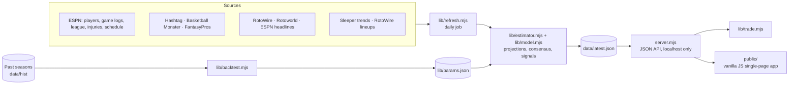

# Pivot

A decision tool for one ESPN fantasy basketball **points** league. Every morning it pulls stats,
rankings, schedules, injuries and news from ten sources, projects every player for the rest of the
season, and turns that into the day's decisions: who to start, who to add, and which trades to make,
each with the reasoning behind it.

The projection model is tested the honest way: it is tuned on past NBA seasons and scored on a season
it never saw.

<!-- Add a screenshot or short GIF of the front page and the trade builder here: docs/screenshot.png -->

## What it does

| Page | What you get |
|---|---|
| **Home** | Your standing, today's three most important moves, the players the market misprices most, and the best trade on the table |
| **This week** | Day-by-day best legal lineup with injury and return-date odds, games-cap pacing, and a cap line for when to sit a player |
| **Rankings** | Five ranking desks side by side with Pivot's own projection |
| **Trades** | Mock offers for any player or team, plus a builder for your own. Every offer comes with its argument, a for-and-against breakdown and charts |
| **Waivers** | Best available players matched against your weakest roster spots |
| **News** | Three days of player news ranked by how much it matters to your team, with an optional LLM-written briefing |

## Projection accuracy

`npm run backtest` replays past seasons day by day. At 13 checkpoints through each season it asks the
model for every relevant player's rest-of-season fantasy points per game, using only what was known
that day, then compares with what the player actually averaged afterwards.

Tuned on 2021-22, 2023-24 and 2024-25 (11,627 projections). Scored on **2025-26**, held out
entirely (4,070 projections):

| Method | Average miss (MAE, FP/G) | RMSE | Next two weeks (MAE) |
|---|---|---|---|
| **Pivot model** | **3.87** | **4.87** | **5.35** |
| Previous version of this model | 3.99 | 5.03 | 5.44 |
| Season average to date | 4.37 | 5.63 | 5.54 |
| Preseason projection | 5.48 | 6.95 | 6.90 |
| Last 15 days | 5.59 | 7.24 | 6.42 |

That is an 11% smaller miss than the season average, the number most fantasy players go by. The
error on the tuning seasons (3.92) is close to the held-out error, so the model is not overfitting.
2022-23 is left out of tuning because ESPN's stored "preseason" projections for that season were
revised mid-season, which would leak the answer.

Known weak spot: the model runs about 1.5 to 2.5 FP/G high for the very best players (predicted 51.4,
actual 49.1 in the top band), mostly because stars get rested and shut down late in seasons.

### How the projection works

Fantasy points per game = minutes × points per minute, and the two behave differently. Minutes follow
role and change fast; per-minute production is a slow-moving skill. So `lib/estimator.mjs` estimates
each from the game log with its own recency half-life (28 days for minutes, 90 for efficiency), shrinks
both toward a preseason prior that fades as games pile up, corrects for shooting luck, then blends in
FantasyPros' rest-of-season projection. The half-lives, prior strengths and corrections are fitted by
coordinate descent in `lib/backtest.mjs` and stored in `lib/params.json`.

On top of that, `lib/model.mjs` redistributes production from injured players to teammates, estimates
games remaining from injury reports and a durability model (also fitted on past seasons), and converts
everything to value above replacement. In a games-capped league, replacement level comes from the
league's remaining games, not its roster spots.

## Trade engine

`lib/trade.mjs` judges a trade by what it does to your **projected final total**, not by adding up
points per game: it re-fills your remaining games cap with the new roster, forces drops or adds the
best free agent so roster sizes stay legal, and does the same for the other team. It also models how
the other manager will see the deal, using recent box scores, expert rank and draft position, plus a
premium for giving up the best player in the deal. That gives an acceptance estimate.

Each trade gets a short argument (the number, the best reason, the main risk) and a full breakdown
across production, form, role and minutes, availability, schedule, price, roster fit and the other
side. Confidence compares the edge with the model's measured error on those players.

The acceptance estimate is a heuristic. There is no data on real trade outcomes to test it against.

## Architecture



- **No framework, one runtime dependency** (the Anthropic SDK, used only for the optional briefing).
  The server is Node's `http` module, and the UI is plain JavaScript with hand-drawn SVG charts.
- **Every source can fail on its own.** Each fetch is tracked, and a broken site shows up in Settings
  and the status bar without stopping the update.
- **Scrapers are split into fetch and parse.** The parsers are pure functions with unit tests; the live
  sites are checked separately with `npm run check:sources`.
- **Secrets stay local.** League cookies and API keys live in `data/settings.json` (owner-only
  permissions, git-ignored), are never sent back to the browser, and go only to the service they
  belong to. The server answers only requests addressed to localhost.

## Running it

Requires Node 20+.

```bash
npm install
npm start               # http://localhost:5178
```

Then open Settings and enter your ESPN league ID. A private league also needs your `espn_s2` and
`SWID` cookies.

```bash
npm test                # unit tests (node:test)
npm run lint            # ESLint
npm run backtest        # re-tune and re-score the projection model
npm run refresh         # run the daily update without the server
npm run check:sources   # hit every live source and report what it returned
```

## Data and terms

This is a personal tool. ESPN's fantasy API is unofficial, and the ranking and news sites are read
from their public pages. Check each site's terms before running it anywhere public, and credit the
sources if you publish anything built from them. No scraped data is committed to this repository.

## Project layout

```
server.mjs              web server and API
lib/sources.mjs         fetchers and parsers for every source
lib/history.mjs         season-long game logs from ESPN
lib/estimator.mjs       the per-game estimate shared by the live model and the backtest
lib/backtest.mjs        tuning and held-out evaluation
lib/model.mjs           projections, consensus, market value, signals, waivers, weekly plan
lib/trade.mjs           trade evaluation and mock offers
lib/news.mjs            news classification, league outcomes, LLM briefing
lib/refresh.mjs         the daily job
public/                 the app
test/                   unit tests
scripts/                live source check
```
