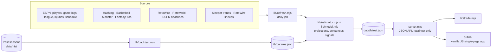

# Pivot

I built Pivot for my own ESPN fantasy basketball league. Every morning it pulls stats, rankings,
schedules, injuries and news from ten sources, projects each player for the rest of the season, and
works out the day's decisions: who to start, who to pick up, and which trades are worth making. Every
suggestion comes with the reasons behind it.

It works with any ESPN points league, season-long or head-to-head. Category leagues run too, but with
a stand-in (see below).

[Live demo](https://quvex.github.io/pivot/). It runs on a frozen snapshot of a real league with the
team names changed, and there's nothing to install. The trade tool runs in your browser, so you can
draft offers against that league.

<!-- Add a screenshot or short GIF of the front page and the trade builder here: docs/screenshot.png -->

## Pages

| Page | What it shows |
|---|---|
| Home | Your standing, the three things to do today, the players the market misprices most, and the best trade available |
| This week | Your best legal lineup for each day, with injury and return-date odds. Games-cap pacing in capped leagues, and the current matchup with a win probability in head-to-head ones |
| Rankings | Five ranking sites side by side with Pivot's own projection |
| Trades | Mock offers for any player or team, and a builder for your own. Each offer gets a written case for and against, plus charts. Past trades shows every deal made in the league and what each side has produced since |
| Waivers | The best free agents, matched against the weakest players on your roster |
| News | The last three days of player news, sorted by how much each item matters to your team, with an optional briefing written by an LLM |

## How accurate the projections are

`npm run backtest` replays past seasons a day at a time. At 13 points in each season it asks the
model for every relevant player's fantasy points per game over the rest of the season, using only
what was known that day. Then it checks what the player actually averaged.

Each test season is scored by a model tuned only on the seasons before it, so nothing from the future
leaks in. The numbers below are mean absolute error in FP/G, where lower is better. The ranges in
brackets are 95% intervals from a bootstrap that resamples whole players, since one player's
projections across a season aren't independent of each other.

| Test season | Tuned on | Pivot | Season average | Previous model | Gain over season average |
|---|---|---|---|---|---|
| 2023-24 | 2021-22 | 4.04 (3.74 to 4.36) | 4.68 | 4.12 | 14% |
| 2024-25 | 2021-22, 2023-24 | 3.77 (3.53 to 4.02) | 4.34 | 3.89 | 13% |
| 2025-26 | 2021-22, 2023-24, 2024-25 | 3.87 (3.64 to 4.11) | 4.37 | 3.99 | 11% |

Pooled over all three seasons (11,791 projections of 1,063 player-seasons):

| Method | MAE | 95% range | Worse than Pivot by |
|---|---|---|---|
| Pivot | 3.89 | 3.75 to 4.05 | |
| Previous version of the model | 4.00 | 3.84 to 4.16 | 0.11 (0.07 to 0.15) |
| Season average to date | 4.46 | 4.28 to 4.65 | 0.57 (0.45 to 0.69) |
| Preseason projection | 5.26 | 5.02 to 5.52 | 1.37 (1.21 to 1.57) |
| Last 15 days | 5.74 | 5.61 to 5.88 | 1.85 (1.71 to 1.99) |

The season average is the number most fantasy players go by, and Pivot beats it by a similar margin
in all three seasons. The improvement over my earlier version of the model is real but small: 0.11
FP/G, with an interval that stays above zero.

I left 2022-23 out of both tuning and testing. ESPN's stored "preseason" projections for that season
were revised partway through, so using them would leak the answer.

### What each piece is worth

This is the full model with one piece removed at a time, pooled over the three test seasons. A
positive change means the model does worse without that piece.

| Piece removed | MAE | Change (95% range) | Verdict |
|---|---|---|---|
| Preseason prior | 4.26 | +0.37 (0.27 to 0.47) | Matters most |
| Minutes × efficiency split (replaced by one re-tuned fantasy-points series) | 3.97 | +0.08 (0.05 to 0.12) | Helps |
| Recency weighting | 3.96 | +0.07 (0.02 to 0.12) | Helps |
| Return dip after an absence | 3.90 | +0.01 (0.00 to 0.03) | Barely matters overall, a lot for the few it touches |
| Top-end trim for stars | 3.90 | +0.01 (0.00 to 0.01) | Barely matters |
| Shooting-luck correction | 3.89 | +0.00 (-0.02 to 0.03) | No measurable effect |

I kept the shooting-luck correction because it costs nothing, but on this evidence it doesn't earn
its place. The live app also blends in FantasyPros' rest-of-season projection. There's no history of
that feed to replay, so it isn't in these numbers.

### What news adds

I tested news the same way as everything else: replay it day by day and see whether knowing it
would have helped. ESPN's player news only goes back about three weeks, so the history comes from
the NBA's official injury reports, which stay online. `scripts/fetch-reports.mjs` downloads the
evening report for every day of the four seasons (692 reports, about 69,000 lines) and
`lib/reports.mjs` reads both PDF layouts the league has used.

Each line carries a written reason, and there are 2,282 distinct wordings ("Left Knee; Meniscus
Tear", "Right Heel; Enthesopathy", "Return to Competition Reconditioning"). A language model reads
each wording once and grades it from 0 to 5 for how long that kind of absence usually lasts
(`lib/reasons.mjs`, grades saved in `lib/reasons.json`). The model only sorts wordings into groups.
What each group is worth in games is measured from the training seasons, never taken from the
model. For a player newly listed out, the share of his team's next two weeks of games he went on to
play was 61% at grade 1, 52% at grade 2, 33% at grade 3 and 26% at grade 4.

Results on the three test seasons, against the same model using box scores alone (negative is
better, 95% ranges in brackets):

| Forecast | Box scores | With the report | Change |
|---|---|---|---|
| FP/G, rest of season (players listed or out) | 4.04 | 4.01 | -0.02 (-0.10 to 0.04) |
| FP/G, next 14 days (players listed or out) | 5.78 | 5.76 | -0.02 (-0.07 to 0.03) |
| Share of games played, next 14 days (everyone) | 0.200 | 0.195 | -0.006 (-0.007 to -0.005) |
| Total fantasy points, next 14 days (everyone) | 46.0 | 45.1 | -0.9 (-1.1 to -0.7) |
| Total fantasy points, rest of season (everyone) | 285.4 | 282.7 | -2.7 (-4.1 to -1.4) |
| Games played, next 14 days (players listed out) | 0.304 | 0.279 | -0.025 (-0.031 to -0.019) |
| Total fantasy points, next 14 days (players listed out) | 55.4 | 50.5 | -4.9 (-6.0 to -3.6) |
| Total fantasy points, rest of season (players listed out) | 336.5 | 324.1 | -12.4 (-21.5 to -4.1) |

What I take from this:

- **News does not improve points per game.** Once a player's own box scores are in, the report adds
  nothing measurable to how well he plays when he plays.
- **News improves how many games he plays.** For a player listed out, the two-week points forecast
  gets about 9% better. That is the number a weekly lineup or a waiver claim depends on.
- **The language model beats keyword rules only at long range.** Over two weeks, keyword matching
  ("sprain", "surgery") does as well (-4.5 against -4.9). Over the rest of the season the model's
  finer grades hold up (-12.4) and the keyword version's range crosses zero (-4.7, -12.2 to 2.7).
- **Teammate injuries are worth little for rest-of-season FP/G.** I gave the model perfect
  foresight of every teammate's future absences as a ceiling test, and the error only fell from 3.90
  to 3.85. Guessing those absences from box scores did not help at all (3.91), so that feature is
  not in the model.
- **Players coming off a layoff run below their level, and box scores alone show it.** After 3 to
  7 missed games the old model was 2.1 FP/G too high over the next two weeks, and after 21 or more
  it was 4.8 too high for the rest of the season. That correction is now in the model as the
  "return dip".

#### Timetables from headlines

A report says a player is out and why. A headline sometimes says for how long ("out four to six
weeks", "to miss the rest of the season"). `scripts/fetch-headlines.mjs` downloads ESPN's dated
NBA headlines for the same four seasons (about 4,600 that tag one to four players), and a language
model reads each one and pulls out what it states: 1,309 absences, 1,083 of them with a length, and
423 returns (`lib/headlines.mjs`). Only those facts are kept; the wording stays ESPN's. A stated
timetable then counts down from the day of the article and expires, so old news stops applying.

Added on top of the report with graded reasons, on the same three test seasons:

| Forecast | Report only | Plus headline timetables | Change |
|---|---|---|---|
| FP/G, rest of season (players listed or out) | 4.01 | 4.03 | +0.01 (0.00 to 0.03) |
| Total fantasy points, next 14 days (everyone) | 45.1 | 44.8 | -0.3 (-0.4 to -0.2) |
| Total fantasy points, next 14 days (players listed out) | 50.5 | 48.6 | -1.9 (-2.4 to -1.4) |
| Total fantasy points, rest of season (players listed out) | 324.1 | 319.2 | -4.9 (-9.3 to -0.7) |

The pattern is the same as the report's. Headlines sharpen how many games an injured player will
play, and do nothing for points per game (if anything they make it slightly worse, so they are not
used there). Stacked together, box scores to report to headlines takes the two-week points error
for a player listed out from 55.4 to 48.6, about 12% better.

One bug worth recording: my first version let a "season-ending" headline follow a player into the
next season. The backtest still showed a gain, which is a reminder that a number going down is not
proof the feature is right. A live run caught it when a healthy player showed up as out for months.

### Live track record

A backtest can always be tuned a little too well, so the app also keeps score in real time. Every
daily update saves its projections. Once a snapshot is a week old, each projection is compared with
what the player has averaged since, next to his season average on the day the projection was made.
The results show up under Settings, in Projection accuracy. Logging started on 14 November 2026.

One known weak spot: for the very best players the model runs 1.5 to 2.5 FP/G high (51.4 predicted
against 49.1 actual in the top band of 2025-26). Most of that is stars being rested or shut down late
in the season, and the top-end trim only corrects a little of it.

### How the projection works

Fantasy points per game is minutes times points per minute, and the two behave differently. Minutes
follow a player's role and can change in a week. Per-minute production is a skill and moves slowly.
So `lib/estimator.mjs` estimates each one separately from the game log, with its own recency
half-life (28 days for minutes, 90 for efficiency). Both are pulled toward a preseason prior that
fades as games pile up. After a shooting-luck correction, the result is blended with FantasyPros'
rest-of-season projection. The half-lives, prior strengths and corrections are fitted by coordinate
descent in `lib/backtest.mjs` and saved in `lib/params.json`.

`lib/model.mjs` then hands production from injured players to their teammates. It estimates how many
games each player has left from a durability model fitted on past seasons. For a player who is out,
it averages ESPN's published return date with what history says about players listed out for a
reason graded like his (`lib/absence.mjs`), using today's official NBA report when it is available
and any timetable a recent headline has stated (read by the language model, if one is set up).
Everything is converted to value above replacement. In a league with a games cap,
replacement level comes from the games left to play across the league rather than from roster spots.

## Trade engine

`lib/trade.mjs` scores a trade by its effect on your projected final total. Adding up points per game
would miss most of what matters. The engine refills your remaining games with the new roster, makes
the drops or free-agent pickups needed to keep both rosters legal, and does the same for the other
team.

It also guesses how the other manager will see the deal. People judge trades on recent box scores,
expert rankings and where a player was drafted, and they want a premium for giving up the best
player in the deal. That gives an acceptance estimate. It's a heuristic, since there's no data on
real trade outcomes to test it against.

Each trade gets a short summary (the number, the best reason to do it, the main risk) and a full
breakdown covering production, form, role and minutes, availability, schedule, price, roster fit and
the view from the other side. The confidence level compares the edge with the model's measured error
on those players.

## Leagues and formats

On first run Pivot asks for your league link. If the league is private, it asks for the two ESPN
cookies (`espn_s2` and `SWID`) that prove you're a member. Then you pick your team. A preview endpoint
checks the league before anything is saved.

Season-long points leagues get games-cap pacing and a cap line. Head-to-head points leagues get
standings by record and a card for the current matchup. That card adds the score so far to each
team's best lineup for the remaining days and turns the gap into a win probability using
game-to-game variance. Category and roto leagues load fine, but Pivot only projects fantasy points,
so it ranks players there on ESPN's default points scoring as a stand-in.

## Architecture



There's no framework and one runtime dependency, the Anthropic SDK, which only the optional briefing
uses. The server is Node's `http` module and the UI is plain JavaScript with SVG charts drawn by hand.

Any source can fail without stopping the update. Each fetch is tracked, and a broken site shows up in
Settings and in the status bar. The scrapers are split into a fetch and a parse step, so the parsers
are pure functions with unit tests, and `npm run check:sources` checks the live sites separately.

League cookies and API keys stay in `data/settings.json`, which is readable only by its owner and
ignored by git. They're never sent back to the browser, and each one only goes to the service it
belongs to. The server only answers requests addressed to localhost.

## Running it

You need Node 20 or later.

```bash
npm install
npm start               # http://localhost:5178
```

The first page walks you through connecting your league.

```bash
npm test                # unit tests (node:test)
npm run lint            # ESLint
npm run backtest        # re-tune and re-score the projection model
npm run refresh         # run the daily update without the server
npm run check:sources   # hit every live source and report what it returned
npm run demo:snapshot   # write a scrubbed snapshot of your league to demo/state.json
npm run demo:build      # assemble the static demo in site/
```

### The public demo

The demo is the same front end running read-only. `demo:snapshot` builds the page state from a real
refresh and then strips out anything that isn't mine to publish. Team, owner and league names are
replaced. News text and injury-report wording are dropped, though Pivot's own take on each news item
stays. From the ranking sites, only ESPN's projection rank and the combined consensus are kept. The
script refuses to write the file if any original name or secret is still in it.

In the browser, the trade engine (`lib/trade.mjs` has no dependencies) runs client-side, so mock
offers and the builder work live. GitHub Actions publishes the demo to GitHub Pages on every push.

### Hosting it for other people

`PIVOT_HOSTED=1 npm start` runs one server for many visitors (`lib/hosted.mjs`). Rankings, stats
and news are pulled once a day for everyone. Each visitor gets an anonymous session cookie and
their own settings: league, team, scoring, manual roster and untouchables. There are no accounts
or passwords. A visitor's league is read from ESPN when they use the app and kept for half an
hour. Their dataset is rebuilt from the shared pull with their league's scoring and size, which
takes about a second and is then cached. Private-league cookies are encrypted at rest with
`PIVOT_SECRET`. The written briefing runs once a day for everyone, and only if the server has
`ANTHROPIC_API_KEY`. Faces and headshots are off. Requests are rate-limited per address.

The `Dockerfile` builds this mode, with data on a volume at `/data`. `render.yaml` deploys it to
Render as a web service with a 1 GB disk.

| Variable | Meaning |
|---|---|
| `PIVOT_HOSTED` | `1` for hosted mode |
| `PIVOT_SECRET` | encrypts visitors' ESPN cookies; keep it stable |
| `PIVOT_DATA_DIR` | where data and visitor settings live |
| `PIVOT_REFRESH_HOUR` | local hour after which the daily pull runs (default 6, Eastern) |
| `ANTHROPIC_API_KEY` | optional: the shared written briefing |

### The players on the court

Each figure on the home page is a realistic male base mesh (CC0, by Orange Juice Games, in
`public/models`), reshaped to the player's listed height and weight and dressed in a kit cut from
the body by skin weight. An invisible Mixamo X Bot holds the basketball stances and the idle
breathing, and the visible body copies its bone rotations every frame.

Faces are optional, free and stay on your machine. `npm run faces:setup` installs
[TripoSR](https://github.com/VAST-AI-Research/TripoSR) (MIT) into `.faces/`, about 4 GB with
PyTorch and the model. The court then offers to turn each player's ESPN headshot into a 3D bust,
about 20 seconds a player on an M4 (`scripts/faces.py`, run by `lib/heads.mjs`). Each bust is
trimmed at the neck and set on the body's head, and the body takes its skin tone from the face.
The busts are saved in `data/heads`, which is never committed, and only the local server serves
them. The public demo has no server, so it shows no faces: real players' likenesses aren't mine to
publish.

## Data and terms

This is a personal tool. ESPN's fantasy API is unofficial, and the ranking and news sites are read
from their public pages. Check each site's terms before running it anywhere public, and credit the
sources if you publish anything built from them. The repository contains no raw scraped pages or
ranking lists.

## Project layout

```
server.mjs              web server and API
lib/sources.mjs         fetchers and parsers for every source
lib/history.mjs         season-long game logs from ESPN
lib/estimator.mjs       the per-game estimate shared by the live model and the backtest
lib/backtest.mjs        tuning, rolling-origin evaluation, bootstrap intervals, ablation
lib/reports.mjs         the NBA's official injury reports, past and present (PDF readers)
lib/reasons.mjs         grades the written reason on a report line; reasons.json holds the grades
lib/headlines.mjs       timetables stated in news headlines, extracted by a language model
lib/absence.mjs         what an absence is worth: games played and the return dip, from past seasons
lib/livescore.mjs       scores saved daily projections against what happened since
lib/model.mjs           projections, consensus, market value, signals, waivers, weekly plan, matchup odds
lib/trade.mjs           trade evaluation and mock offers (also runs in the browser)
lib/pasttrades.mjs      scores each past trade: before, since and still ahead for both sides
lib/ownership.mjs       who owns each player
lib/state.mjs           the page state the UI renders
lib/news.mjs            news classification, league outcomes, LLM briefing
lib/refresh.mjs         the daily job
public/                 the app
test/                   unit tests
scripts/                live source check, demo snapshot and build, report and headline download, AI reading
demo/state.json         the scrubbed snapshot the public demo runs on
```
